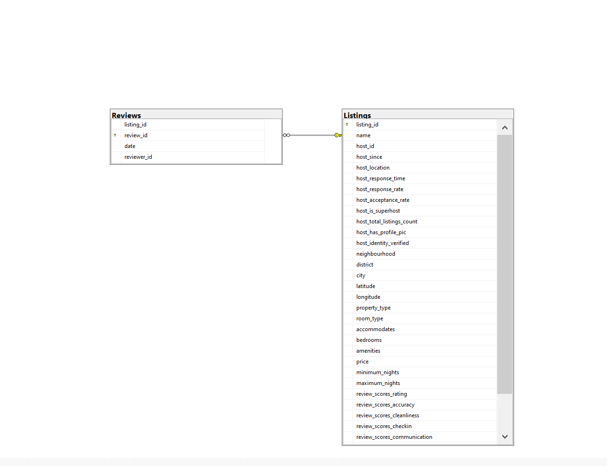
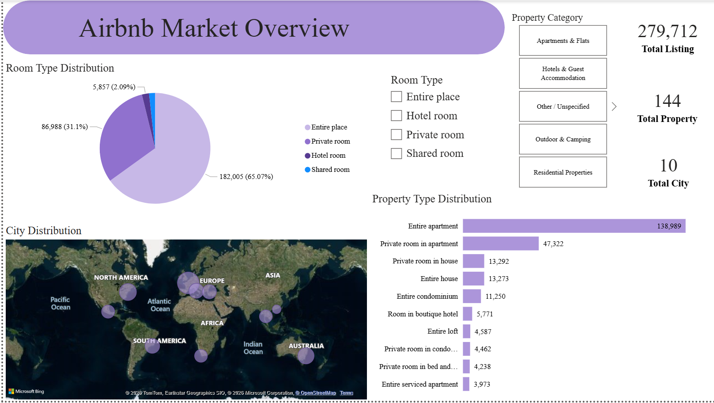
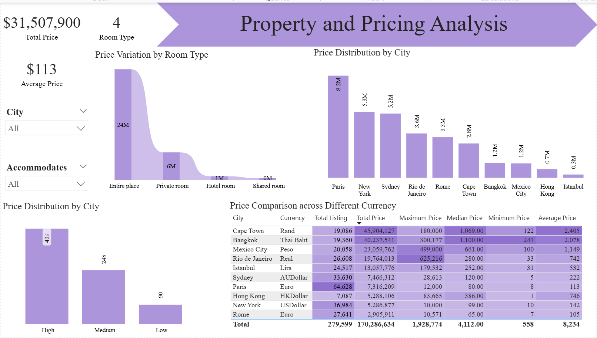
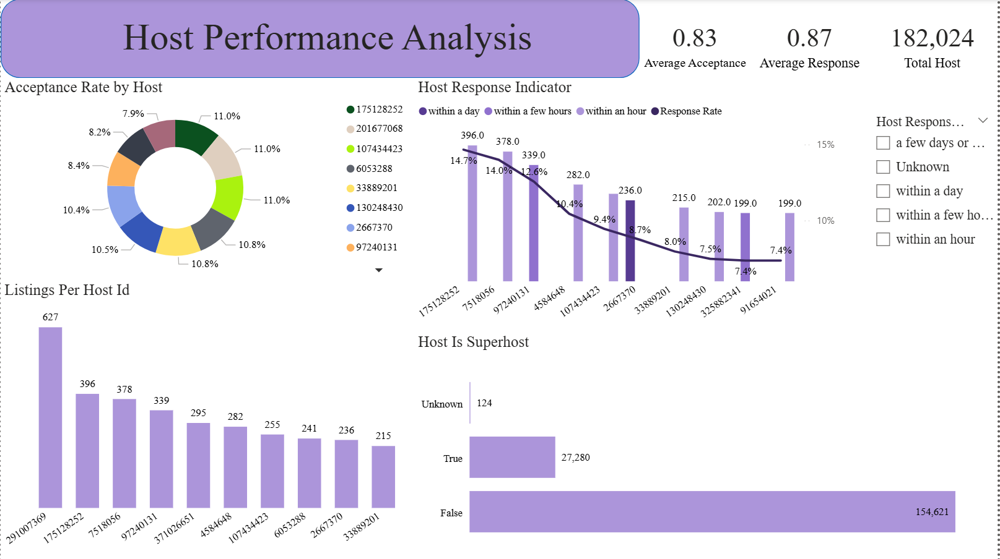
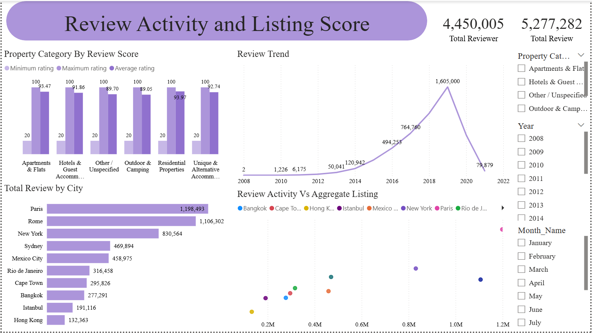

# Airbnb Market Intelligence Project
### Data Analysis | SQL Server | Power BI | AnalystLab Africa Internship


## Table of Contents
1. [Project Overview](#1-project-overview)
2. [Business Problem](#2-business-problem)
3. [Project Objectives](#3-project-objectives)
4. [Business Questions](#4-business-questions)
5. [Dataset Description](#5-dataset-description)
6. [Tools and Technologies](#6-tools-and-technologies)
7. [Data Cleaning and Preparation](#7-data-cleaning-and-preparation)
8. [Data Modelling](#8-data-modelling)
9. [Exploratory Data Analysis and Findings](#9-exploratory-data-analysis-and-findings)
10. [Key Business Insights](#10-key-business-insights)
11. [Business Recommendations](#11-business-recommendations)
12. [Project Limitations](#12-project-limitations)
13. [Further Project Development](#13-further-project-development)
14. [Conclusion](#14-conclusion)

---

## 1. Project Overview

The Airbnb Market Intelligence Project was undertaken as part of my Data Analyst Internship at **AnalystLab Africa**.

The project focuses on analysing Airbnb listing data across ten cities to understand listing distribution, advertised pricing patterns, property characteristics, host performance indicators and historical review information.

Using SQL Server for data cleaning, transformation and exploratory analysis, the project aims to transform raw accommodation data into meaningful insights that can support property-market evaluation and business decision-making.

The broader project also involves developing an interactive Power BI dashboard, investigating price prediction opportunities and exploring how validated market insights can be made accessible through a Generative AI assistant.

## 2. Business Problem

The accommodation marketplace operates across different cities, each with its own property characteristics, pricing patterns, accommodation types and market conditions.

Stakeholders require a better understanding of how Airbnb listings are distributed across cities, what property characteristics are associated with advertised prices, how host performance indicators differ and how historical review activity varies across listings.

Without structured analysis, identifying meaningful differences between markets and developing reliable insights for property-market evaluation can be challenging.

This project addresses these challenges through structured analysis of Airbnb listing information across ten cities.

## 3. Project Objectives

The main objectives of this project are to:

- Understand Airbnb listing distribution across selected cities.
- Investigate advertised pricing patterns across different markets.
- Compare property types and room types.
- Examine host characteristics and available performance indicators.
- Analyse historical review activity.
- Investigate listing-level review ratings.
- Develop an appropriate price prediction model.
- Provide access to validated market information through an interactive dashboard or Generative AI assistant.
- Apply professional project management practices throughout the project lifecycle.

## 4. Business Questions

The analysis is guided by the following business questions:

1. Which cities have the highest and lowest numbers of Airbnb listings?
2. How do advertised listing prices vary across the ten cities?
3. Which room types and property types are most common?
4. What listing characteristics are associated with higher advertised prices?
5. How do host characteristics and performance indicators vary across cities?
6. Which listings receive the highest review activity?
7. How do listing-level review scores differ across property types and locations?
8. Are there observable relationships between review activity and listing-level review ratings?
9. Can listing prices be estimated using property characteristics and other available listing information?
10. How can stakeholders access validated market insights through an interactive dashboard or AI-powered assistant?
11. How can the project be planned, coordinated, tested and delivered professionally?

## 5. Dataset Description

The dataset contains Airbnb listing information across ten cities, including property characteristics, host information, advertised prices, booking conditions and listing-level review scores.

### Key Dataset Variables

| Category | Columns |
|---|---|
| Listing Information | listing_id, name |
| Host Information | host_id, host_since, host_location |
| Host Performance | host_response_time, host_response_rate, host_acceptance_rate |
| Host Characteristics | host_is_superhost, host_total_listings_count, host_has_profile_pic, host_identity_verified |
| Location | neighbourhood, district, city, latitude, longitude |
| Property Characteristics | property_type, room_type, accommodates, bedrooms, amenities |
| Pricing | price |
| Booking Conditions | minimum_nights, maximum_nights, instant_bookable |
| Review Information | review_scores_rating, review_scores_accuracy, review_scores_cleanliness, review_scores_checkin, review_scores_communication, review_scores_location, review_scores_value |

**Important:** The dataset contains listing-level information rather than actual booking transactions. Therefore, the analysis focuses on advertised prices, available host indicators and historical review information.

## 6. Tools and Technologies

| Tool | Purpose |
|---|---|
| SQL Server | Data cleaning, transformation, querying and exploratory analysis |
| Power BI | Data modelling, interactive visualisation and dashboard development |
| Microsoft Excel | Supporting data inspection and analysis |

## 7. Data Cleaning and Preparation

Data cleaning was performed to improve data consistency, reliability and suitability for analysis.

### 7.1 Data Inspection
- Examined the dataset structure and available columns.
- Reviewed data types and relevant analytical fields.
- Identified different currencies across the ten cities.
- Examined missing and potentially invalid values.

### 7.2 Property Type Categorisation

The original `property_type` column contained 144 distinct values.

To simplify comparisons and improve interpretability, property types were grouped into broader categories.

This made it easier to analyse the distribution of accommodation types across the dataset.

### 7.3 Currency Standardisation

The dataset contained advertised prices in different local currencies.

To enable cross-city price comparisons, listing prices were converted into United States Dollars (USD).

A separate analysis was also conducted using original local currencies to understand advertised pricing patterns within individual markets.

### 7.4 Listing Completeness

Four important columns were prioritised when assessing basic listing completeness:

- `listing_id`
- `name`
- `property_type`
- `room_type`

Listings containing valid information across these four fields were considered complete for basic identification and categorisation purposes.

### 7.5 Price Validation

The price column was examined for unusual values, including:

- Zero-priced listings.
- Extremely high advertised prices.
- Unusually low advertised prices.

Zero-priced records were identified in New York, Mexico City, Istanbul, Bangkok, Rome, Paris and Rio de Janeiro.

These records require further investigation before being used in final pricing conclusions.

## 8. Data Modelling

The data modelling stage involved organising the prepared data into a structure suitable for analysis and interactive reporting in Power BI.

The objective was to establish meaningful relationships between the listing attributes and supporting analytical tables.

### Data Model

<!-- Replace the image path below with your actual screenshot location in the repository -->



*Figure 1: Airbnb Market Intelligence Data Model.*

## 9. Exploratory Data Analysis and Findings

### 9.1 Listing Distribution Across Cities

**Business Question:** Which cities have the highest and lowest numbers of Airbnb listings?

**Findings:**
- Paris recorded the highest number of listings, with **646,900**.
- Hong Kong recorded the lowest number of listings, with **7,087**.

This indicates considerable differences in listing distribution across the selected markets.

### 9.2 Room Type Distribution

**Findings:**
- Entire-place accommodations recorded the highest number of listings, with **182,005**.
- Shared rooms recorded the lowest number of listings, with **4,862**.

Entire-place accommodation represents the largest room-type category in the analysed dataset.

### 9.3 Property Type Distribution

The original dataset contained 144 distinct property types, which were grouped into broader categories.

**Findings:**
- Entire apartments were the most common individual property type, with **138,989 listings**.
- Apartments and flats were the most common broader property category, with **218,211 listings**.

### 9.4 Advertised Price Comparisons Across Cities (USD)

To make cross-city comparisons meaningful, advertised prices were converted into USD.

| Metric | City | Price (USD) |
|---|---|---:|
| Highest maximum price | Rio de Janeiro | $112,538.88 |
| Lowest maximum price | Istanbul | $3,590.54 |
| Highest minimum price | New York | $10.00 |
| Lowest minimum price | Hong Kong | $0.13 |
| Highest average price | Sydney | $153.19 |
| Lowest average price | Istanbul | $10.65 |

The results demonstrate differences in advertised prices across the ten cities.

However, extreme prices and zero-priced listings require further validation before final interpretation.

### 9.5 Advertised Prices Within Local Currencies

In addition to USD comparisons, prices were analysed using their original local currencies.

**Findings:**
- Cape Town recorded the highest average advertised price at **2,405 South African rand**.
- Bangkok recorded the highest median advertised price at **1,100 Thai baht**.
- Bangkok also recorded the highest minimum advertised price at **241 Thai baht**.
- Hong Kong recorded the lowest minimum advertised price at **1 Hong Kong dollar**.
- Rio de Janeiro recorded the highest maximum advertised price at **625,216 Brazilian real**.

This analysis provides additional context for understanding advertised prices within individual markets.

### Dashboard Images
***Market Overview***


***Property and Pricing Analysis***


***Host Performance Analysis***


***Review Activity and Listing Score***



### 9.6 Host Performance Indicators

The analysis examined host response and acceptance rates across the selected cities.

| Indicator | City | Average Rate |
|---|---|---:|
| Highest response rate | Cape Town | 0.91 |
| Lowest response rate | Istanbul | 0.83 |
| Highest acceptance rate | Bangkok | 0.91 |
| Lowest acceptance rate | Rio de Janeiro | 0.76 |

**Findings:**
- Host response rates ranged from 0.83 to 0.91.
- Cape Town recorded the highest average response rate.
- Istanbul recorded the lowest average response rate.
- Bangkok recorded the highest acceptance rate.
- Rio de Janeiro recorded the lowest acceptance rate.

The relatively narrow response-rate range suggests limited variation in average response rates across the reported cities.

*Note: Response rate and response time are different indicators. The figures above represent response rates.*

### 9.7 Listing-Level Review Scores

The analysis examined the overall listing review score, measured on a scale of 0 to 100.

**Finding:**

A total of **57,458 listings** recorded an overall review score of 100.

This represents listings with the highest available overall rating in the dataset.

Further analysis can investigate how review scores differ across cities and property categories.

### 9.8 Property Characteristics Associated With Higher Advertised Prices

The analysis considered:

- Property type and property category.
- Room type.
- Amenities.
- Advertised price.
- Accommodation capacity.
- Number of bedrooms.

The USD price column was used to support consistent comparisons.

The 75th percentile (P75) was calculated using `PERCENTILE_CONT` to establish a threshold for identifying the top 25% of advertised prices.

**Findings:**

Apartments and flats were identified as the property category with the highest reported average advertised price among the categories examined.

| Property Characteristic | Finding |
|---|---:|
| Property Category | Apartments and Flats |
| Average Advertised Price | $242 |
| Average Accommodation Capacity | 4 Guests |
| Average Bedrooms | 1 |
| Number of Listings | 55,409 |

These findings provide a basis for investigating how accommodation characteristics relate to advertised prices.

The results are descriptive and do not establish that property type causes higher prices.

## 10. Key Business Insights

### Insight 1: Listing Distribution Is Concentrated in Particular Markets

Paris recorded 646,900 listings, while Hong Kong recorded 7,087.

This demonstrates substantial differences in the size of the listing markets.

**Business implication:**

Stakeholders can use listing distribution to understand the relative scale of the markets and investigate competition and property differentiation.

However, listing volume alone does not establish actual demand or profitability.

### Insight 2: Advertised Pricing Differs Across Cities

Sydney recorded the highest average advertised price at $153.19, while Istanbul recorded the lowest at $10.65.

**Business implication:**

Stakeholders should adopt city-specific pricing benchmarks rather than applying a single pricing strategy across all markets.

Comparisons should also account for property characteristics and local market conditions.

### Insight 3: Property Characteristics Are Relevant to Price Evaluation

Apartments and flats were the most common property category, with 218,211 listings.

The reported high-priced property analysis identified apartments and flats with an average advertised price of $242, average capacity of four guests and one bedroom.

**Business implication:**

Property category, room type, accommodation capacity, bedrooms and amenities should be considered together when evaluating advertised prices.

Further modelling is needed to establish which characteristics have the strongest relationship with price.

## 11. Business Recommendations

### Recommendation 1: Develop City-Specific Market Evaluation Strategies

Stakeholders should evaluate each city independently, considering listing concentration, local advertised prices and accommodation categories.

This would provide a more accurate basis for comparing markets and evaluating property opportunities.

### Recommendation 2: Use Comparable Properties for Pricing Evaluation

Pricing evaluations should consider similar properties based on property category, room type, accommodation capacity, bedrooms and amenities.

City-specific median advertised prices can also provide useful comparison benchmarks while reducing the influence of extreme values.

### Recommendation 3: Monitor Host Performance and Listing Quality

Stakeholders should monitor host response rates, acceptance rates, verification indicators and listing-level review scores.

This could help identify differences in available host performance indicators and areas requiring further investigation.

## 12. Project Limitations

The following limitations should be considered when interpreting the results:

- Advertised prices do not represent actual booking revenue.
- Listing counts do not establish guest demand or occupancy.
- Zero-priced and extreme-price records require validation.
- Review scores represent available listing-level ratings and should not automatically be interpreted as complete measures of guest sentiment.
- Historical review activity does not represent every booking.
- Observed relationships between property characteristics and prices do not establish causation.
- Currency comparisons depend on the exchange rates and conversion methodology used.

## 13. Further Project Development

The broader project includes additional analytical and technical deliverables.

| Area | Planned Deliverable |
|---|---|
| Geographic Analysis | Identify neighbourhoods and districts with the highest listing concentrations. |
| Host Analysis | Compare host characteristics and performance indicators across cities. |
| Review Activity | Identify listings with the highest available review activity. |
| Review Quality | Compare listing-level review scores across locations and property categories. |
| Review Relationships | Investigate the relationship between review activity and listing ratings. |
| Price Prediction | Develop and evaluate a listing price prediction model. |
| Interactive Dashboard | Build a Power BI dashboard for market exploration. |
| Generative AI | Explore an AI-powered assistant for accessing validated market insights. |
| Project Management | Document milestones, testing, coordination and final deliverables. |

## 14. Conclusion

The Airbnb Market Intelligence Project provided an opportunity to apply SQL-based data analysis techniques to a large, multi-city accommodation dataset.

Through data cleaning, property categorisation, currency standardisation and exploratory analysis, meaningful patterns were identified in listing distribution, accommodation types, advertised prices and host performance indicators.

The findings demonstrate that listing distribution and advertised pricing vary across cities, while property characteristics provide useful information for evaluating accommodation listings.

The analysis establishes a foundation for further investigation into host performance, historical review activity, listing quality and price prediction.

Ultimately, the project demonstrates how structured data analysis can transform raw accommodation data into meaningful market insights that support informed property-market evaluation and business decision-making.

---

**Project:** Airbnb Market Intelligence  
**Organisation:** AnalystLab Africa  
**Role:** Data Analyst Intern  
**Tools:** SQL Server | Power BI

```SQL
--Create Database
CREATE DATABASE Airbnb_Analytics

--Checking for duplicate value in the review table
SELECT DISTINCT *
FROM Reviews
 
SELECT review_id, COUNT(*) AS Occurance
FROM Reviews
GROUP BY review_id
HAVING COUNT(*) > 1

--Running a query that show the original values along side the duplicate values
--Total entries show how many times a record appear in the table, so rows with 2 or more entries 
--are duplicates.
SELECT 
    listing_id, 
    review_id, 
    date, 
    reviewer_id,
    COUNT(*) OVER (PARTITION BY listing_id, reviewer_id) AS total_entries,
    ROW_NUMBER() OVER (PARTITION BY listing_id, reviewer_id ORDER BY date ASC) AS instance_number
FROM Reviews
ORDER BY listing_id, reviewer_id, date

--Deleting duplicates Values
WITH RankedReviews AS (
    SELECT *,
        ROW_NUMBER() OVER (
            PARTITION BY review_id
            ORDER BY listing_id ASC
        ) AS Row_Num
    FROM Reviews
)
DELETE FROM RankedReviews
WHERE Row_Num > 1

--Checking for missing values
--No missing missing/null values in the review table
SELECT 
  SUM(CASE WHEN listing_id IS NULL THEN 1 ELSE 0 END) AS Missing_listing_id,
  SUM(CASE WHEN review_id IS NULL THEN 1 ELSE 0 END) AS Misssing_review_id,
  SUM(CASE WHEN date IS NULL THEN 1 ELSE 0 END) AS Missing_date,
  SUM(CASE WHEN reviewer_id IS NULL THEN 1 ELSE 0 END) AS Missing_reviewer_id
FROM Reviews

--Checking for duplicate value in the listing table
--No duplicate values on the listing tables
SELECT DISTINCT *
FROM listings

--Checking for missing values
SELECT 
  SUM(CASE WHEN listing_id IS NULL THEN 1 ELSE 0 END) AS Missing_listing_id,
  SUM(CASE WHEN name IS NULL THEN 1 ELSE 0 END) AS Misssing_name,
  SUM(CASE WHEN host_id IS NULL THEN 1 ELSE 0 END) AS Missing_host_id,
  SUM(CASE WHEN host_since IS NULL THEN 1 ELSE 0 END) AS Missing_host_since,
  SUM(CASE WHEN host_location IS NULL THEN 1 ELSE 0 END) AS Missing_host_location,
  SUM(CASE WHEN host_response_time IS NULL THEN 1 ELSE 0 END) AS Misssing_hrt,
  SUM(CASE WHEN host_response_rate IS NULL THEN 1 ELSE 0 END) AS Missing_hresponse_rate,
  SUM(CASE WHEN host_acceptance_rate IS NULL THEN 1 ELSE 0 END) AS Missing_har,
  SUM(CASE WHEN host_is_superhost IS NULL THEN 1 ELSE 0 END) AS Missing_hisuperhost,
  SUM(CASE WHEN host_total_listings_count IS NULL THEN 1 ELSE 0 END) AS Misssing_htlcounts,
  SUM(CASE WHEN host_has_profile_pic IS NULL THEN 1 ELSE 0 END) AS Missing_hhprofilepicture,
  SUM(CASE WHEN host_identity_verified IS NULL THEN 1 ELSE 0 END) AS Missing_hiv,
  SUM(CASE WHEN neighbourhood IS NULL THEN 1 ELSE 0 END) AS Missing_neighbourhood,
  SUM(CASE WHEN district IS NULL THEN 1 ELSE 0 END) AS Misssing_district,
  SUM(CASE WHEN city IS NULL THEN 1 ELSE 0 END) AS Missing_city,
  SUM(CASE WHEN latitude IS NULL THEN 1 ELSE 0 END) AS Missing_latitude,
  SUM(CASE WHEN longitude IS NULL THEN 1 ELSE 0 END) AS Missing_longitude,
  SUM(CASE WHEN property_type IS NULL THEN 1 ELSE 0 END) AS Misssing_property_type,
  SUM(CASE WHEN room_type IS NULL THEN 1 ELSE 0 END) AS Missing_room_type,
  SUM(CASE WHEN accommodates IS NULL THEN 1 ELSE 0 END) AS Missing_accommodates,
  SUM(CASE WHEN bedrooms IS NULL THEN 1 ELSE 0 END) AS Missing_bedrooms,
  SUM(CASE WHEN amenities IS NULL THEN 1 ELSE 0 END) AS Misssing_amenities,
  SUM(CASE WHEN price IS NULL THEN 1 ELSE 0 END) AS Missing_price,
  SUM(CASE WHEN minimum_nights IS NULL THEN 1 ELSE 0 END) AS Missing_minimum_nights,
  SUM(CASE WHEN maximum_nights IS NULL THEN 1 ELSE 0 END) AS Missing_maximum_nights,
  SUM(CASE WHEN review_scores_rating IS NULL THEN 1 ELSE 0 END) AS Misssing_rsr,
  SUM(CASE WHEN host_has_profile_pic IS NULL THEN 1 ELSE 0 END) AS Missing_hhpp,
  SUM(CASE WHEN review_scores_accuracy IS NULL THEN 1 ELSE 0 END) AS Missing_rca,
  SUM(CASE WHEN review_scores_cleanliness IS NULL THEN 1 ELSE 0 END) AS Missing_rscleanliness,
  SUM(CASE WHEN review_scores_checkin IS NULL THEN 1 ELSE 0 END) AS Misssing_rscheckin,
  SUM(CASE WHEN review_scores_communication IS NULL THEN 1 ELSE 0 END) AS Missing_rscommunication,
  SUM(CASE WHEN review_scores_location IS NULL THEN 1 ELSE 0 END) AS Missing_rslocation,
  SUM(CASE WHEN review_scores_value IS NULL THEN 1 ELSE 0 END) AS Missing_rsvalue,
  SUM(CASE WHEN instant_bookable IS NULL THEN 1 ELSE 0 END) AS Missing_instant_bookable
FROM Listings

--Replacing missing values
--Replacing missing/null values in district column to unknown
--With 242700 district null column, it was replaced but would not be used for the analysis as it can distort it. 
UPDATE Listings
SET district = 'Unknown'
WHERE district IS NULL

--Replacing null host reponse time with unknown, but not response rate and acceptance rate
--because replacing it with zero would be giving it a false performance rate.
UPDATE Listings
SET host_response_time = 'Unknown'
WHERE host_response_time IS NULL

--Replacing Null host_is_super_host, host_has_profile_picture and host_identity_verified column to null
UPDATE Listings
SET host_is_superhost = 'Unknown'
WHERE host_is_superhost IS NULL

UPDATE Listings
SET host_has_profile_pic = 'Unknown'
WHERE host_has_profile_pic IS NULL

UPDATE Listings
SET host_identity_verified = 'Unknown'
WHERE host_identity_verified IS NULL

--Replacing Null names with unknown
UPDATE Listings
SET name = 'Unknown'
WHERE name IS NULL

--Replacing Null host location with unknown
UPDATE Listings
SET host_location = 'Unknown'
WHERE host_location IS NULL

--Converting all the various currency to USD with the current conversion rate
ALTER TABLE Listings
ADD Price_in_USD DECIMAL(10, 2)

--Adding Paris and Rome Price at the same time as they use the same currency
UPDATE Listings
SET Price_in_USD = Price*1.12
WHERE city IN ('Paris', 'Rome')

UPDATE Listings
SET Price_in_USD = Price*0.02
WHERE city = 'Istanbul'

UPDATE Listings
SET Price_in_USD = Price*0.18
WHERE city = 'Rio de Janeiro'

UPDATE Listings
SET Price_in_USD = Price*0.13
WHERE city = 'Hong Kong'

UPDATE Listings
SET Price_in_USD = Price*0.69
WHERE city = 'Sydney'

UPDATE Listings
SET Price_in_USD = Price*0.03
WHERE city = 'Bangkok'

UPDATE Listings
SET Price_in_USD = Price*0.06
WHERE city = 'Cape Town'

UPDATE Listings
SET Price_in_USD = Price*0.05
WHERE city = 'Mexico City'

UPDATE Listings
SET Price_in_USD = Price*1
WHERE city = 'New York'

--Checking for negative price value in the converted price column
--No negative value in the converted price column
SELECT City, Price, Price_in_USD
FROM Listings
WHERE Price_in_USD <1

--Adding primary key to the listings and reviews table
ALTER TABLE Listings
ADD CONSTRAINT PK__list_id
PRIMARY KEY (listing_id)

ALTER TABLE Reviews
ADD CONSTRAINT PK__review_id
PRIMARY KEY (review_id)

--Create relationship between the tables
ALTER TABLE Reviews
ADD CONSTRAINT FK_listing_id
FOREIGN KEY (listing_id) REFERENCES Listings(listing_id)

--Feature Engineering
--Creat property category to properly group them
--Grouping property type into category
ALTER TABLE Listings
ADD property_category VARCHAR(100)

UPDATE Listings
SET property_category =
    CASE
        -- Apartments and flats
        WHEN property_type LIKE '%apartment%'
          OR property_type LIKE '%condominium%'
          OR property_type LIKE '%aparthotel%'
          OR property_type LIKE '%loft%'
          OR property_type LIKE '%floor%'
        THEN 'Apartments & Flats'

        -- Outdoor and camping
        WHEN property_type LIKE '%tent%'
          OR property_type LIKE '%campsite%'
          OR property_type LIKE '%camper%'
          OR property_type LIKE '%yurt%'
          OR property_type LIKE '%tipi%'
          OR property_type LIKE '%hut%'
          OR property_type LIKE '%igloo%'
          OR property_type LIKE '%parking space%'
        THEN 'Outdoor & Camping'

        -- Unique and alternative accommodation
        WHEN property_type LIKE '%castle%'
          OR property_type LIKE '%cave%'
          OR property_type LIKE '%earth house%'
          OR property_type LIKE '%dome house%'
          OR property_type LIKE '%treehouse%'
          OR property_type LIKE '%windmill%'
          OR property_type LIKE '%lighthouse%'
          OR property_type LIKE '%island%'
          OR property_type LIKE '%boat%'
          OR property_type LIKE '%train%'
          OR property_type LIKE '%bus%'
        THEN 'Unique & Alternative Accommodation'

        -- Hotels and guest accommodation
        WHEN property_type LIKE '%hotel%'
          OR property_type LIKE '%hostel%'
          OR property_type LIKE '%guesthouse%'
          OR property_type LIKE '%guest suite%'
          OR property_type LIKE '%bed and breakfast%'
          OR property_type LIKE '%resort%'
          OR property_type LIKE '%pension%'
          OR property_type LIKE '%pousada%'
          OR property_type LIKE '%minsu%'
          OR property_type LIKE '%kezhan%'
          OR property_type LIKE '%casa particular%'
          OR property_type LIKE '%nature lodge%'
          OR property_type LIKE '%holiday park%'
        THEN 'Hotels & Guest Accommodation'

        -- Residential properties
        WHEN property_type LIKE '%house%'
          OR property_type LIKE '%home%'
          OR property_type LIKE '%villa%'
          OR property_type LIKE '%townhouse%'
          OR property_type LIKE '%bungalow%'
          OR property_type LIKE '%cottage%'
          OR property_type LIKE '%cabin%'
          OR property_type LIKE '%chalet%'
          OR property_type LIKE '%tiny house%'
          OR property_type LIKE '%barn%'
          OR property_type LIKE '%farm stay%'
          OR property_type LIKE '%in-law%'
        THEN 'Residential Properties'

        ELSE 'Other / Unspecified'
    END

--Creating Accomdates Category
ALTER TABLE Listings
ADD accommodates_category VARCHAR(50)

UPDATE Listings 
SET accommodates_category =
 CASE 
   WHEN accommodates > 10 THEN 'High'
   WHEN accommodates BETWEEN 6 AND 10 THEN 'Medium'
   ELSE 'Low'
END 

--Analysis
--What city have the highest listing
--Paris has the highest listing with 646900 while Hong Kong has the least with 7087 listing
SELECT TOP 1 city, COUNT(*) AS Total_list
FROM Listings
GROUP BY city
ORDER BY COUNT(*) DESC

--How is listing distributed among room type
--Entire place has the most listing with 182005 and shared room type the least with 4862 listing
SELECT room_type, COUNT(*) AS Total_list
FROM Listings
GROUP BY room_type
ORDER BY COUNT(*) DESC

--Which property type is most common
--The most common property type is entire apartment with 138989 listing.
SELECT property_type, COUNT(*) AS Total_list
FROM Listings
GROUP BY property_type
ORDER BY COUNT(*) DESC

--Because the property type is large with 144 distinct values so I categorized the property type
--Analysis of the most common property category
--The most common property category is apartment and flats with 218211 listings.
SELECT property_category, COUNT(*) AS Total_list
FROM Listings
GROUP BY property_category
ORDER BY COUNT(*) DESC

--How do advertised prices vary across cities, with the same currency?
--Findings after converting the prices to USD, The city with the highest maximum price
--is Rio de Janeiro with 112538.88 and the least maximum price is 3590.54 in Instabul 
--City with the highest minimum price is New York with 10.00 
--Hong Kong has the least minimum price with 0.13
--Sydney has the highest average price of 153.19 while Instabul has the least with 10.65.
--Although cities like new york, mexico city, istanbul, bangkok, rome, paris, rio de janeiro have recorded price of
--zero(0).
SELECT City,
    COUNT(*) AS Total_listing,
    SUM(price_in_USD) AS Total_price,
    ROUND(AVG(price_in_USD), 2) AS Avg_price,
    MIN(price_in_USD) AS Minimum_price,
    MAX(price_in_USD) AS Maximum_price
FROM Listings
WHERE Price_in_USD > 0
GROUP BY City
ORDER BY MAX(price_in_USD) DESC

--How do advertised prices vary across cities, within each local currency?
--Create a currency column to make my analysis easier
ALTER TABLE Listings
ADD Currency VARCHAR(30)

UPDATE Listings
SET Currency = 
  CASE 
    WHEN City LIKE 'Paris' THEN 'Euro'
    WHEN City LIKE 'Rome' THEN 'Euro'
    WHEN City LIKE 'Istanbul' THEN 'Lira'
    WHEN City LIKE 'Hong Kong' THEN 'HKDollar'
    WHEN City LIKE 'New York' THEN 'USDollar'
    WHEN City LIKE 'Cape Town' THEN 'Rand'
    WHEN City LIKE 'Sydney' THEN 'AUDollar'
    WHEN City LIKE 'Rio de Janeiro' THEN 'Real'
    WHEN City LIKE 'Bangkok' THEN 'Thai Baht'
    ELSE 'Peso'
END

--Advertised prices within each local currency
--How are advertised prices distributed within each city's market? Using its original currency
--Capetown has the highest average price of 2405 rands while Bangkok accounts for the highest median price with 1100 baht
--and the highest minimum price of 241 baht while Hong kong has the least minimum price of 1 hong kong dollar.
--Rio de Janeiro has the highest maximum price of 625216 real. 
WITH Prices AS (
    SELECT City, 
        Currency,Price,
        PERCENTILE_CONT(0.50) 
         WITHIN GROUP(ORDER BY Price)
         OVER(PARTITION BY City, Currency) AS Median_price
    FROM Listings)
SELECT City, 
   Currency,
   SUM(Price) AS Total_price,
   COUNT(*) AS Total_listing,
   AVG(Price) AS Avg_price,
   MAX(Median_price) AS Median_price,
   MIN(Price) AS Minimum_price,
   MAX(Price) AS Maximum_price
FROM Prices
WHERE Price > 0
GROUP BY City, Currency
ORDER BY SUM(Price) DESC

--Which neighbourhoods or districts have the largest listing concentrations? Where the data is suffiiciently complete
--To determine if a listing is complete, I'd priortize 4 columns which are the listing id,
--name, property type and room type
WITH Listing_CTE AS (
    SELECT neighbourhood, 
        CASE 
         WHEN listing_id IS NOT NULL
         AND NAME IS NOT NULL
         AND property_type IS NOT NULL
         AND room_type IS NOT NULL
         THEN 'Complete Listing'
         ELSE 'Incomplete Listing'
       END AS Listing_info
    FROM Listings)
SELECT neighbourhood,
  COUNT(*) AS Total_listing,
  Listing_info
FROM Listing_CTE
GROUP BY neighbourhood, Listing_info
ORDER BY COUNT(*) DESC

--Which listings have the highest available review scores?
--A Total of 57458 listing has a rating score of 100
SELECT listing_id,
 MAX(review_scores_rating) AS rating_score
FROM Listings
WHERE review_scores_rating  = (SELECT 
                                 MAX(review_scores_rating)
                               FROM Listings)
GROUP BY listing_id


--How many reviews are recorded for each listing?
SELECT li.listing_id, li.name,
   COUNT(*) AS Total_reviews
FROM Reviews re
RIGHT JOIN Listings li
  ON re.listing_id = li.listing_id
GROUP BY li.listing_id, name
ORDER BY COUNT(*) DESC

--How does review activity change over time?
--Create two column to extract year and month from the date column on reviews table
--Month Name
ALTER TABLE Reviews
ADD Month_Name VARCHAR(30)

UPDATE Reviews 
SET Month_Name = DATENAME(MONTH, date) 

--Month Number Column
ALTER TABLE Reviews
ADD Month_No INT

UPDATE Reviews 
SET Month_No = MONTH(date)

--Year Column 
ALTER TABLE Reviews
ADD Year INT

UPDATE Reviews 
SET Year = YEAR(date)

--Review Activity change over time
SELECT Year, Month_Name,
  COUNT(*) AS Total_Review
FROM Reviews
GROUP BY Year, Month_Name, Month_No
ORDER BY Year, Month_No

--How do host response and acceptance indicators vary across cities?
--Changing host_response_rate and host_response_rate column from varchar to decimal
ALTER TABLE Listings
ALTER COLUMN host_response_rate DECIMAL(5,2)

ALTER TABLE Listings
ALTER COLUMN host_acceptance_rate DECIMAL(5,2)

--Cape Town has the highest average response time of 0.91 , while Istanbul has the least 0.83
--On average all cities response time is fast because the range is between 0.91 to 0.83, 
--there is no low/slow response time. Host reponse time do not differ acrosss city.
--Bangkok has the most acceptance rate of 0.91 while Rio de Janeiro has the least with 0.76.
SELECT City, 
   COUNT(*) AS Total_listing,
   ROUND(AVG(host_acceptance_rate), 2) AS Avg_acceptance_time, 
   ROUND(AVG(host_response_rate), 2) AS Avg_response_time
FROM Listings
GROUP BY city
ORDER BY AVG(host_response_rate) DESC

--Which property characteristics are most common among higher-priced listings?
--To determine a property characteristics we need the property_type, room type, amenities,
--price, accommodates, bedrooms.
--For the analysis I would use price in USD column because all the price now have the same value.
--Query to show the properties with high listings
--Using perntile cont of 0.75 percent to get the top 25% property pricing from the dataset
WITH Price_CTE AS (
    SELECT *,
        PERCENTILE_CONT(0.75)
        WITHIN GROUP (ORDER BY Price_in_USD)
        OVER() AS Price_Threshold
    FROM Listings
)
SELECT *
FROM Price_CTE
WHERE Price_in_USD >= Price_Threshold

--Characteristics that are common among high listing properties using property category
--Apartments and flats are the most priced property category with an average price of 242 dollars and an average 
--accommodates of 4 guests, 1 bedroom and 55409 lsiting.
WITH Price_CTE AS (
    SELECT *,
        PERCENTILE_CONT(0.75)
        WITHIN GROUP (ORDER BY Price_in_USD)
        OVER() AS Price_Threshold
    FROM Listings
),
High_Price AS (
    SELECT *
    FROM Price_CTE
    WHERE Price_in_USD >= Price_Threshold
)
SELECT
    property_category,
    COUNT(*) AS Total_Listings,
    AVG(Price_in_USD) AS Avg_Price,
    AVG(bedrooms) AS Avg_Bedrooms,
    AVG(accommodates) AS Avg_Accommodates
FROM High_Price
GROUP BY property_category
ORDER BY Total_Listings DESC 
```
